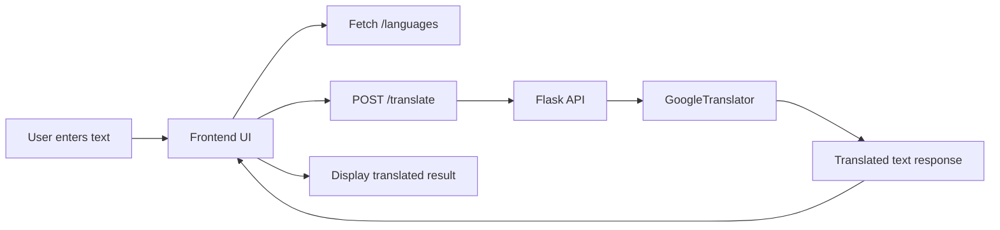

 ## Language Translator

<div align="center">


</div>

A lightweight web application that translates user-entered text into multiple supported languages using a Flask backend and a responsive frontend. The project demonstrates a simple full-stack workflow with a REST API and browser-based UI.

## Overview

This app allows users to:
- enter text in any language
- select a target language from a supported list
- send the content to a backend API for translation
- view the translated output instantly in the browser

The translation service uses the `deep-translator` library powered by Google Translate, making the app easy to run and extend for learning or small real-world use cases.

## Features

- Clean, single-page translation interface
- Auto-generated language dropdown populated from backend data
- POST-based translation API
- Support for multiple target languages
- Simple, beginner-friendly Flask architecture
- Cross-origin support via Flask CORS

## Tech Stack

- Python 3
- Flask
- Flask-CORS
- deep-translator
- JavaScript
- HTML5
- CSS3

## Project Structure

```text
Git/
├── backend/
│   └── app.py
├── frontend/
│   ├── index.html
│   ├── script.js
│   └── style.css
├── README.md
└── .gitignore (if present)
```

## Workflow Diagram



## How It Works

1. The browser loads the frontend interface from the Flask static folder.
2. The app requests the list of supported languages from `/languages`.
3. When the user clicks translate, the selected text and target language are sent to `/translate`.
4. The backend calls `GoogleTranslator(source="auto", target=target)` to detect the source language automatically and translate it.
5. The translated text is returned as JSON and rendered on the page.

## API Endpoints

### GET /languages
Returns the supported language mappings as JSON.

Example response:

```json
{
  "bn": "Bangla",
  "en": "English",
  "fr": "French",
  "ja": "Japanese"
}
```

### POST /translate
Translates the provided text into the selected language.

Request body:

```json
{
  "text": "Hello, how are you?",
  "target": "fr"
}
```

Response:

```json
{
  "translated_text": "Bonjour, comment ça va ?"
}
```

## Setup and Run

### 1. Clone the project

```bash
git clone <repository-url>
cd Git
```

### 2. Create a virtual environment (optional but recommended)

```bash
python -m venv venv
source venv/bin/activate   # Linux/macOS
venv\Scripts\activate      # Windows
```

### 3. Install dependencies

```bash
pip install Flask Flask-CORS deep-translator
```

### 4. Start the backend server

```bash
cd backend
python app.py
```

The app runs by default on:

```text
http://localhost:5000
```

### 5. Open the app

Visit:

```text
http://localhost:5000
```

## Environment Variables

The app supports the following environment variable:

- `PORT` - Override the default port (default is `5000`)

Example:

```bash
PORT=8000 python app.py
```

## Use Cases

- learning language translation basics
- small utility for multilingual text conversion
- demonstration of Flask + frontend integration
- educational project for API development

## Notes

This project is intentionally simple and beginner-friendly. It is best suited for understanding how a web frontend communicates with a Python backend and how a translation API can be integrated into an application.

## License

This project is provided for educational use. Add a license file if you plan to share or distribute it publicly.

## Author / Project Context

This is a mini full-stack project focused on practical web development and API integration, designed to help users understand how a real-world app can combine frontend interaction with backend logic and external services.
